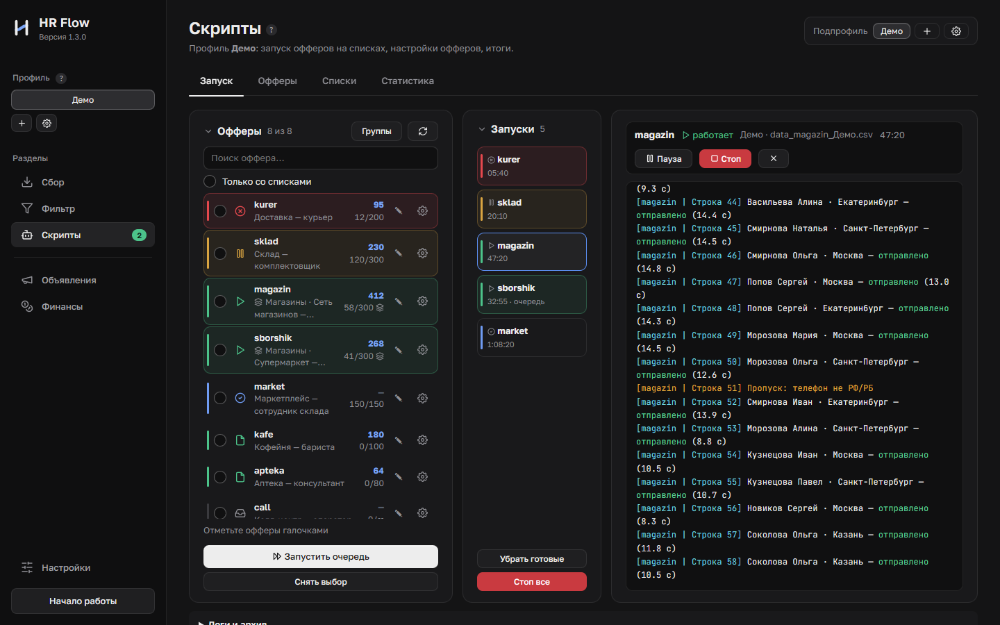
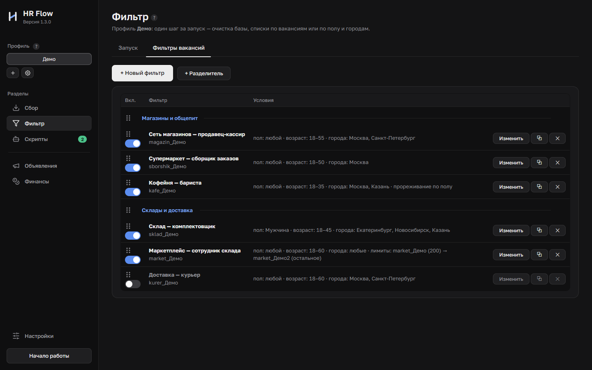
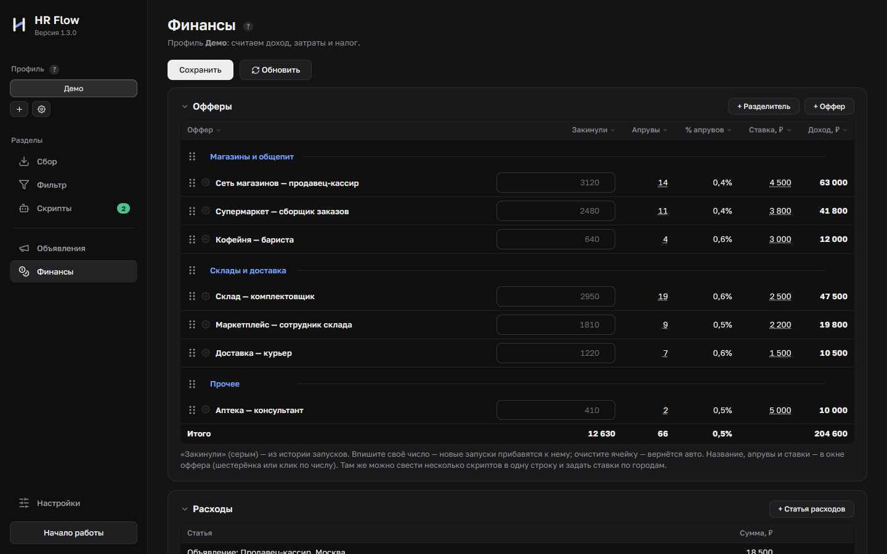
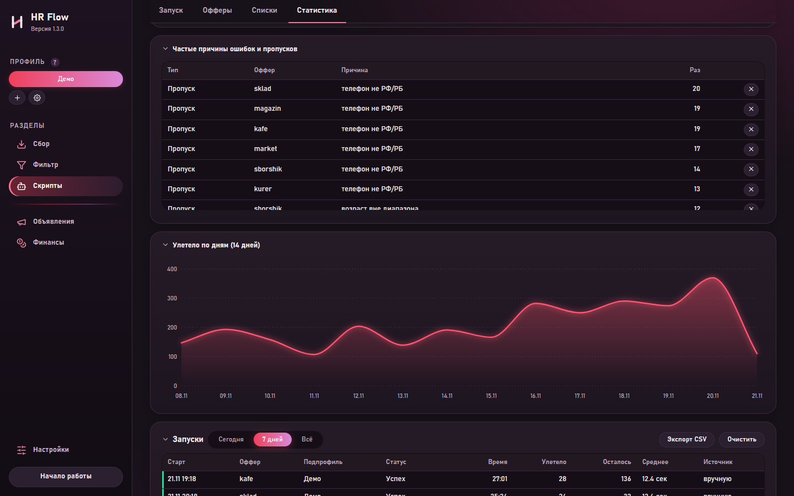
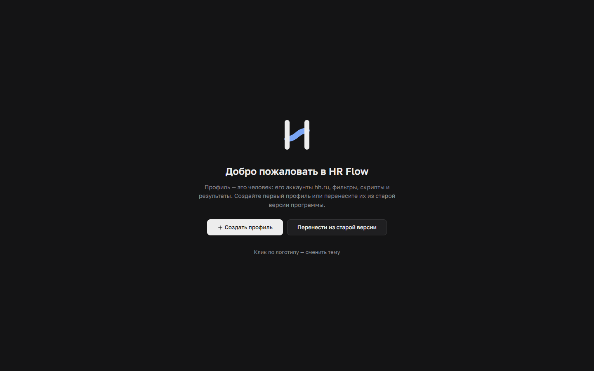
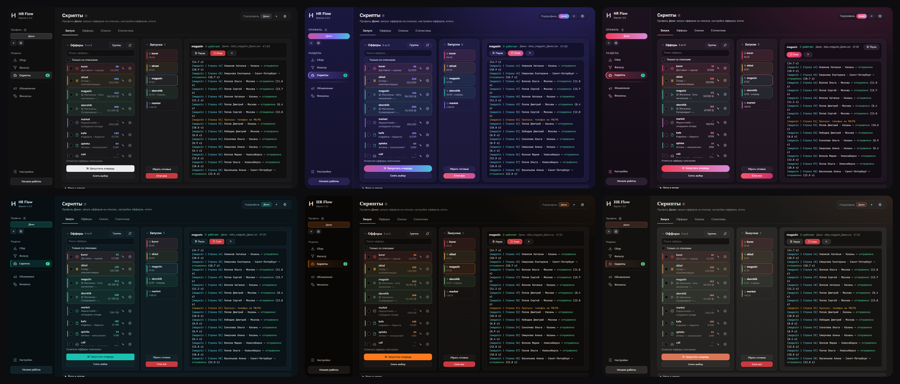

# HR Flow

**Программа для HR-трафика на Windows: от откликов на hh.ru до отправленных анкет и подсчёта дохода.**

&nbsp;

## Что умеет

**Сбор.** Собирает отклики со всех вакансий аккаунта работодателя на hh.ru: ФИО, дату рождения, телефон, пол и город. Несколько аккаунтов, дневные лимиты, сбор из архива по id вакансий.

**Фильтр.** В три шага превращает сырую базу в готовые списки: чистит дубли и мусор, раскладывает людей по вакансиям (пол, возраст, города, лимиты на файл), делит по полу и городам для объявлений. Списки могут сразу уходить в скрипты.

**Скрипты.** Сами заполняют анкеты на сайтах по готовым спискам. Запуск очередью, пауза и остановка, дневные и общие лимиты на группу, несколько списков на оффер, живая консоль. Офферы собираются в конструкторе — по шагам, без программирования. Есть «Тест без отправки».

**Объявления и Финансы.** Просмотры, отклики, конверсия и цена отклика по каждому объявлению. Доход по офферам — апрувы × ставка, расходы, налог и чистая прибыль.

**Статистика.** Сколько улетело по дням, успешность запусков, частые причины ошибок и пропусков.

<table>
<tr>
<td width="50%">
Фильтры вакансий с группами
</td>
<td width="50%">
Финансы: доход, расходы, налог
</td>
</tr>
<tr>
<td width="50%">
Статистика запусков
</td>
<td width="50%">
Первый запуск
</td>
</tr>
</table>

## Шесть тем

Графит, Индиго, Рассвет, Океан, Уголь и Claude. Меняются кликом по логотипу, ненужные можно отключить.

## Установка

1. Скачайте **[HR-Flow-Setup.exe](https://github.com/PinkieWRK82/hr-flow-releases/releases/latest/download/HR-Flow-Setup.exe)** и запустите.
2. Откройте HR Flow с ярлыка — создайте профиль или перенесите данные из старой версии.
3. Готово. Python, Node.js и всё нужное уже внутри установщика.

**Нужно:** Windows 10 или 11 (64-бит), Google Chrome, аккаунт работодателя на hh.ru.

## Обновления

Программа сама проверяет новые версии — при запуске и раз в час. Когда выходит обновление, внизу меню появляется кнопка: нажали — скачалось и установилось за несколько секунд. Обновление меняет только файлы программы: профили, списки, результаты, финансы и ваши настройки не трогаются.

Список изменений — на странице [релизов](https://github.com/PinkieWRK82/hr-flow-releases/releases).

Скриншоты сделаны на демо-данных: все имена, офферы и цифры выдуманы.
